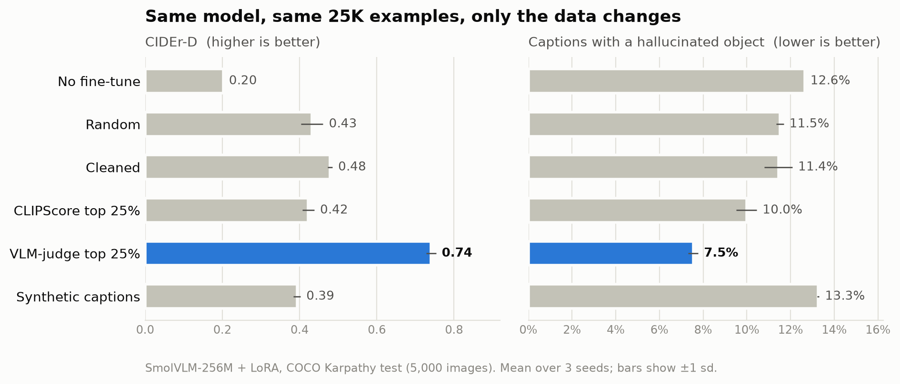
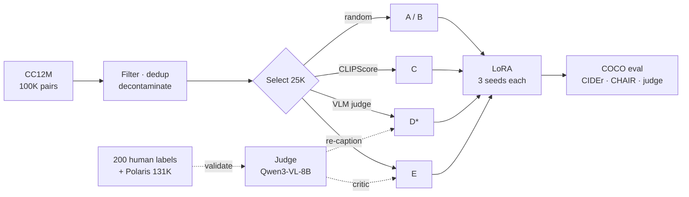

# Data beats size

**Which training data makes a small vision-language model caption better?**
Same model, same recipe, same 25,000 examples. Only the choice of data changes.

> **In plain words.** Most image captions on the web are adverts, keyword lists or copied text, not descriptions.
> We tried five ways of choosing which 25,000 image–caption pairs to teach a small model with, and tested each on the same exam.
> Letting a larger AI model grade the captions, after checking its grades against human ones, and keeping the best quarter
> produced by far the best captioner. A cheaper similarity score did not help, and AI-rewritten captions made the model wordier rather than better.

<picture>
  <source media="(prefers-color-scheme: dark)" srcset="docs/results_dark.png">
  
</picture>

| Training data (25K pairs from CC12M) | CIDEr-D ↑ | Hallucinated object ↓ |
|---|---:|---:|
| No fine-tune | 0.202 | 12.6% |
| Random | 0.432 | 11.5% |
| Cleaned (filters, dedup, decontamination) | 0.479 | 11.4% |
| CLIPScore top 25% | 0.423 | 10.0% |
| **VLM-judge top 25%** | **0.741** | **7.5%** |
| Synthetic captions (generator + critic) | 0.393 | 13.3% |

<sub>SmolVLM-256M + LoRA, COCO Karpathy test (5,000 images), mean of 3 seeds. The judge-selected arm was added after the pre-registered gate and is reported as exploratory.</sub>

## Findings

1. **Selecting data with a calibrated VLM judge raised CIDEr by 71% and cut hallucinations by a third** compared with random data.
2. **CLIPScore selection did not help.** On 200 hand-rated web captions the judge agreed with the human twice as well as CLIPScore (Spearman 0.52 vs 0.25), even though the two are nearly tied on a clean benchmark (0.83 vs 0.82).
3. **Synthetic captions: it depends on the metric.** The student learned long, detailed captions. An independent VLM judge likes them (4.58 / 5, close to the winner's 4.54), but CIDEr drops and more captions contain a hallucinated object. Only the judge-selected arm is strong on all three metrics.
4. **164 test images were hiding in the training pool.** Decontamination removed them.
5. **An agent proposed filter rules; a human rejected all of them.** Its failures (duplicates, overfitting to the labels, a missing guard) are documented.

## What's inside

| Technique | Where |
|---|---|
| Data curation: heuristic filtering, embedding-based **deduplication**, test-set **decontamination** | `filter_pool.py`, `src/datacurate/filters.py` |
| **Down-selection** by CLIPScore vs a **VLM judge**, at a fixed budget | `make_arms.py` |
| VLM judge **calibrated against human labels** (Polaris + 200 blind ratings), bootstrap CIs, human ceiling, **failure-mode** analysis | `notebooks/01_polaris_calibration.ipynb` |
| **Synthetic data**: generator/critic loop with **diversity** and **contamination controls** | `recaption.py` |
| **Agentic, tool-using** rule proposal with a **human-in-the-loop** approval gate | `agent_rules.py`, `results/agent/` |
| **Controlled ablation**: pre-registered, 3 seeds, paired bootstrap | `PREREGISTRATION.md`, `eval_metrics.py` |
| **LoRA** fine-tuning of SmolVLM-256M | `train_lora.py` |
| Infrastructure: **Ray Data**, **vLLM**, AWS S3, W&B, resumable stages | `build_pool.py`, `embed_pool.py`, `run_rest.sh` |

## Pipeline



## Read more

| | |
|---|---|
| [REPORT.md](REPORT.md) | Full technical report: method, judge validation, all results, limitations |
| [PREREGISTRATION.md](PREREGISTRATION.md) | Hypotheses and decision rules, committed before any model output |
| [`results/`](results/) | Every number in the report, as JSON and CSV |

## Run it

```bash
uv venv --python 3.12 && uv pip install -e ".[gpu,dev]"      # GPU machine (A100 80GB used here)
cp .env.example .env                                        # HF token required; W&B and S3 optional
python scripts/check_env.py

# Hand-rated set: rebuild the same 200 pairs, then use the committed ratings
python scripts/make_handrate_set.py && cp artifacts/handrate/ratings.csv data/handrate/

python scripts/smoke_test_judge.py --benchmark              # judge check + throughput table
python scripts/score_polaris.py && python scripts/score_handrate.py
jupyter nbconvert --execute --to notebook --inplace notebooks/01_polaris_calibration.ipynb   # gate
python scripts/build_pool.py && python scripts/fetch_coco.py && python scripts/embed_pool.py
python scripts/agent_rules.py                               # proposals only; approved rules go in configs/filters.yaml
bash scripts/run_rest.sh                                    # filter → arms → re-caption → train → evaluate
python scripts/make_figure.py                               # README chart
```

About 5.5 GPU-hours on one A100 ($10.01 in total). Every stage is resumable. Settings live in `configs/default.yaml`.

To label your own set instead: `python scripts/rate_server.py`, rate in the browser, then `python scripts/merge_handrate.py`.

<details>
<summary>Repository layout</summary>

```
configs/        run settings and filter rules
prompts/        versioned judge rubric (its hash is logged with every score)
src/datacurate/ judge, CLIPScore, calibration, statistics, filters, CIDEr/CHAIR
scripts/        one script per stage; run_rest.sh chains them
notebooks/      judge calibration analysis (no GPU needed)
results/        all outputs behind REPORT.md
tests/          unit tests
```
</details>
