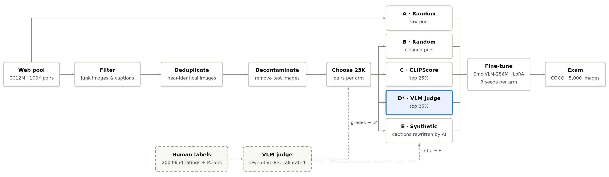

# Data beats size

**Which training data makes a small image-captioning model better?**
Same model, same training recipe, same 25,000 examples. Only the choice of data changes.

> **In plain words.** Most image captions on the web are adverts, keyword lists or copied text, not descriptions.
> We tried five ways of choosing which 25,000 image–caption pairs to teach a small model with, and gave every version the same exam.
> Letting a larger AI model grade the captions (after checking its grades against human ones) and keeping the best quarter
> produced by far the best captioner. A cheaper similarity score did not help, and AI-rewritten captions made the model wordier rather than better.

## How the study works



| Arm | Training data (25K image–caption pairs each) |
|---|---|
| **0** | none: the model as downloaded, as a baseline |
| **A** | random pairs from the raw web pool |
| **B** | random pairs after cleaning (junk filters, duplicate removal, test images removed) |
| **C** | the 25% of the cleaned pool with the highest CLIPScore |
| **D\*** | the 25% of the cleaned pool rated highest by a VLM judge, checked against human ratings first |
| **E** | B's images with new captions written by one AI model and checked by another |

## Results

<picture>
  <source media="(prefers-color-scheme: dark)" srcset="docs/results_dark.png">
  
</picture>

| Arm | Training data | CIDEr-D ↑ | Captions with a hallucinated object ↓ |
|---|---|---:|---:|
| 0 | none | 0.202 | 12.6% |
| A | random | 0.432 | 11.5% |
| B | cleaned, random | 0.479 | 11.4% |
| C | CLIPScore top 25% | 0.423 | 10.0% |
| **D\*** | **VLM-judge top 25%** | **0.741** | **7.5%** |
| E | synthetic captions | 0.393 | 13.3% |

<sub>Mean of 3 training runs per arm, on 5,000 COCO test images. The plan was fixed in advance ([PREREGISTRATION.md](PREREGISTRATION.md)); arm D* was added after one planned checkpoint failed, so it is marked * (exploratory).</sub>

## Findings

1. **Choosing data with a VLM judge worked best by far:** CIDEr up 71% and hallucinating captions down by a third, compared with random data.
2. **CLIPScore did not help, and the reason shows up in the data.** On 200 web captions rated by hand, the judge's ranking matched the human's about twice as well as CLIPScore's (rank agreement 0.52 vs 0.25), even though the two look almost equal on a clean public benchmark (0.83 vs 0.82).
3. **AI-written captions: the verdict depends on the metric.** The model learned to write long, detailed captions. An independent AI grader liked them (4.58 / 5, close to D\*'s 4.54), but they matched human references less well and named more objects that are not in the image. Only D\* is strong on all three measures.
4. **164 test images were hiding in the training data.** They were removed before training, so no model saw its exam in advance.
5. **An AI agent proposed cleaning rules; a human reviewed and rejected all of them.** The agent's mistakes (duplicate rules, memorizing the labeled examples, a missing safety check) are documented.

## Key terms

| Term | Meaning |
|---|---|
| **CC12M** | a public set of ~12M image–caption pairs collected from the web; 100K were used here |
| **COCO** | a standard image-captioning benchmark with 5 human-written captions per image; its 5,000-image "Karpathy" test split is the exam |
| **CIDEr-D** | how closely a generated caption matches the human captions (higher is better) |
| **Hallucinated object** | an object named in the caption that is not in the image, measured with CHAIR (lower is better) |
| **CLIPScore** | a fast image–text similarity score from the CLIP model |
| **VLM judge** | a larger vision-language model (Qwen3-VL-8B) that reads a written rubric and grades each caption 1–5 |
| **Calibrated** | the judge's grades were checked against human grades and mapped onto the human scale |
| **Polaris** | a public set of 131K human ratings of image captions, used to check the judge |
| **SmolVLM-256M + LoRA** | the small model being trained, and a method that trains only a small add-on (2% of its weights) |
| **Rank agreement** | Spearman correlation: 1 = same ranking as the human, 0 = unrelated |

## What's inside

| Technique | Where |
|---|---|
| Data curation: heuristic filtering, embedding-based **deduplication**, test-set **decontamination** | `filter_pool.py`, `src/datacurate/filters.py` |
| **Down-selection** by CLIPScore vs a **VLM judge**, at a fixed budget | `make_arms.py` |
| VLM judge **calibrated against human labels**, bootstrap confidence intervals, human ceiling, **failure-mode** analysis | `notebooks/01_polaris_calibration.ipynb` |
| **Synthetic data**: generator/critic loop with **diversity** and **contamination controls** | `recaption.py` |
| **Agentic, tool-using** rule proposal with a **human-in-the-loop** approval gate | `agent_rules.py`, `results/agent/` |
| **Controlled ablation**: pre-registered, 3 seeds per arm, paired bootstrap | `PREREGISTRATION.md`, `eval_metrics.py` |
| **LoRA** fine-tuning | `train_lora.py` |
| Infrastructure: **Ray Data**, **vLLM**, AWS S3, W&B, resumable stages | `build_pool.py`, `embed_pool.py`, `run_rest.sh` |

## Read more

| | |
|---|---|
| [REPORT.md](REPORT.md) | Full technical report: method, judge validation, all results, limitations |
| [PREREGISTRATION.md](PREREGISTRATION.md) | The plan and decision rules, committed before any model output |
| [`results/`](results/) · [`artifacts/`](artifacts/) | Every number in the report; the training sets, generated captions and hand ratings |

## Run it

Needs a GPU (an A100 80GB was used) and a Hugging Face token.

```bash
uv venv --python 3.12 && uv pip install -e ".[gpu,dev]"
cp .env.example .env                                        # HF token required; W&B and S3 optional
python scripts/check_env.py

# Hand-rated set: rebuild the same 200 pairs, then use the committed ratings
python scripts/make_handrate_set.py && cp artifacts/handrate/ratings.csv data/handrate/

python scripts/smoke_test_judge.py --benchmark              # judge check + throughput table
python scripts/score_polaris.py && python scripts/score_handrate.py
jupyter nbconvert --execute --to notebook --inplace notebooks/01_polaris_calibration.ipynb   # checkpoint
python scripts/build_pool.py && python scripts/fetch_coco.py && python scripts/embed_pool.py
python scripts/agent_rules.py                               # proposals only; approved rules go in configs/filters.yaml
bash scripts/run_rest.sh                                    # clean → arms → re-caption → train → evaluate
python scripts/make_figure.py                               # README figures
```

About 5.5 GPU-hours on one A100 ($10.01 in total). Every stage is resumable. Settings live in `configs/default.yaml`.
To label your own set instead: `python scripts/rate_server.py`, rate in the browser, then `python scripts/merge_handrate.py`.

<details>
<summary>Repository layout</summary>

```
configs/        run settings and filter rules
prompts/        versioned judge rubric (its hash is logged with every score)
src/datacurate/ judge, CLIPScore, calibration, statistics, filters, CIDEr/CHAIR
scripts/        one script per stage; run_rest.sh chains them
notebooks/      judge calibration analysis (no GPU needed)
results/        all numbers behind REPORT.md
artifacts/      training sets, generated captions, hand ratings
tests/          unit tests
```
</details>
